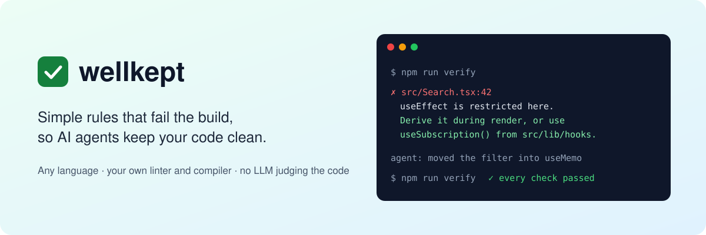
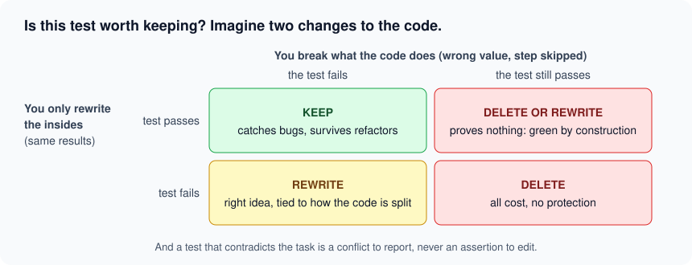

<p align="center">
  
</p>

<p align="center">
  An agent skill for Claude Code, Codex, Cursor and any agent that reads <code>SKILL.md</code>.<br>
  It finds the mistakes agents keep making in your repo and turns each one into a check that fails the build.
</p>

---

## Why

> **"Nuance tends to lead to slop."** (Lauren "poteto" Tan, AI Engineer Code)

When doing something right takes judgment, agents get it wrong. They copy the nearest example, take the shortest path that compiles, and talk their way around rules written in `AGENTS.md`.

`useEffect` is the classic case. Derived state, event handling and real syncing all look like an effect, so agents reach for it every time, and the codebase fills up with effect soup that the next agent copies.

A sentence in a doc doesn't fix that. **A failing build does.** wellkept gives the agent an explicit alternative and makes the wrong way stop compiling, with an error message that tells it what to use instead.

## Install

```sh
npx skills add antomanc/skills --skill wellkept
```

## Use it

Open your agent in the project and ask for it:

| Agent | Say |
| --- | --- |
| Claude Code | `/wellkept` |
| Codex, Cursor, others | "Run the wellkept skill on this repo" |

Other things you can ask:

- "Use wellkept to stop agents from writing raw useEffect here."
- "Turn the rules in AGENTS.md into lint rules with wellkept."
- "Check with wellkept whether our tests prove anything."
- After a few weeks of work: "Run wellkept again."

The agent looks around, then **stops and shows you a plan**. Nothing changes until you say yes. You can drop or change any item.

```
wellkept plan: shop-web

Found: 23 useEffect calls, 14 of them in ProductSearch.tsx copying props into state
(src/ProductSearch.tsx:31-88). "Don't read Date.now() in components" is in AGENTS.md:12
but there are 6 reads. 9 tests mock ../api and break on every refactor.

1. Effects: derive during render; useSubscription() for real syncing.
   Check: oxlint no-restricted-imports on useEffect outside src/lib/hooks. Replaces: nothing.
2. Clock: useNow(). Check: no-restricted-properties on Date.now in src/components.
   Replaces: AGENTS.md:12.
Tests: rewrite search.test.ts at the public seam (fails "change the internals": mocks ../api).
Not doing: the setTimeout in scripts/retry.ts is a CLI backoff, fine there.
```

## How it works


It is a skill, so the agent does the work. There are no scripts to install and no service to run. Three ideas:

1. **An alternative before a ban.** An agent blocked with no right way to go finds a wrong one. In our tests, banning timers without a timer helper made agents hide a polling loop somewhere else, and it leaked.
2. **Deterministic checks only.** Types, compiler flags, your linter, your architecture tool, your tests. No LLM review as the gate: a check either fails or it doesn't.
3. **Evidence before rules.** A check is proposed only when your repo shows the problem: many occurrences, the same fix landing twice, a rule that lives only in prose. A healthy repo gets a short plan, or none.

### From a rule in a doc to a check


The error message is the most important line: it is the prompt the next agent reads. "Read time through useNow(); a component that reads the clock can't be tested at midnight" works. "Forbidden call" doesn't.

### Tests: fewer, better



Agents copy tests too. A suite full of mocks and assertions that repeat the code teaches the next agent to write more of the same. wellkept keeps the tests that fail when the behavior breaks and survive a refactor, and proposes rewriting or deleting the rest, with your OK. New tests go through the public interface, with literal expected values, mocking only what the project doesn't own.

## What it looks for

The agent decides what matters in your stack. Typical finds:

| | Example | Usual fix |
| --- | --- | --- |
| Effects and reactivity | `useEffect` copying props into state, `$effect` setting a value | derive it; named hooks for real syncing |
| Timers | "wait 300 ms, then scroll" | wait for the real event; a few cleaning-up helpers |
| Clock and randomness | `Date.now()` deep in a component | pass `now` in, or one clock provider |
| Escape hatches | `as any`, `!!`, `unwrap()`, `@ts-ignore` | fix the type; exceptions need a reason |
| Layer leaks | the UI importing the database | a dependency rule |
| Workaround comments | "hack: needed because…" | fix the cause, or turn the reason into a check |
| Test slop | mocks of your own modules, snapshots nobody reads | test the public interface |

[references/examples.md](skills/wellkept/references/examples.md) has rule examples for TypeScript, React, Svelte, Vue, Kotlin and Compose, Python, Go, Rust, Swift, .NET and Dart.

## What ends up in your repo

Ordinary project files you'd write yourself:

- a helper or two (`useNow()`, `useSubscription()`);
- rules in your existing linter config, or a small conventions script if nothing else can express them;
- one `verify` command that runs every check, and CI running exactly that;
- a few lines in `AGENTS.md`.

No state files, no extra tooling. Remove the skill and everything keeps working.

## Does it work?

What we know, honestly:

- **Real bugs, found by the audit.** On two real projects (a Kotlin/Compose app and a Svelte web app), the first run found a clock that never ticked on screen, an old error shown after a newer success, a leaked timer and stale test fixtures.
- **Good guardrails are safe; bad ones aren't.** On a small React app over 5 agent tickets, guardrails with sanctioned helpers passed every hidden test in all 4 runs. A version that banned timers without a helper leaked a timer in both of its runs.
- **Simple beats elaborate.** An earlier version also stored and re-proved every check over time. It cost 1.3 to 2.5 times the tokens and filled repos with bookkeeping commits, so it was cut.

Not shown yet: that a repo with wellkept stays cleaner than one without over months of agent work. If you try it, issues with before/after examples are very welcome.

## FAQ

**Will it slow every ticket down?** The agent only notices the checks when it breaks one, and then the error tells it what to do. The cost is mostly the first run.

**Can an agent just disable the rule?** Inline disables have to name the rule and give a reason, enforced by the linter where it can be. Changes to the lint config show up in the diff you review.

**Does it lock me into a tool?** No. It uses what your project already has, and adds a tool only when several rules need one.

**What if my repo is already in good shape?** It should say so and change little. If it proposes rules without evidence from your repo, that's a bug: please open an issue.

## Credits

Built on Lauren "poteto" Tan's talk at AI Engineer Code and her [pstack](https://github.com/cursor/plugins) principles (test behavior, not implementation), and on Matt Pocock's [tdd skill](https://github.com/mattpocock/skills) (test at the seams, never mock your own modules).

## License

MIT
