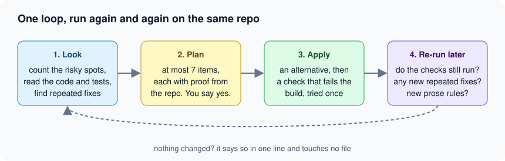
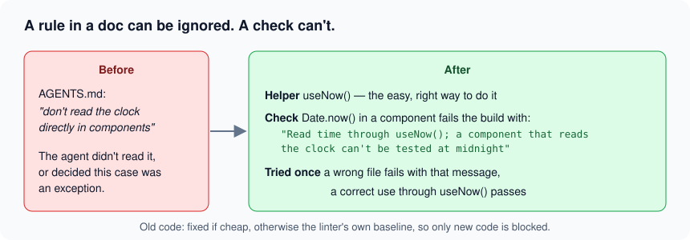

# skills

Agent skills by antomanc. Install with the [skills](https://skills.sh) CLI:

```sh
npx skills add antomanc/skills --skill wellkept
```

## wellkept

**Keeps a codebase clean when most of the code is written by AI agents.** Any language, any framework.

### The idea

> "Nuance tends to lead to slop." (Lauren "poteto" Tan, AI Engineer Code)

When doing something right takes judgment, agents get it wrong. They copy the nearest example, take the shortest path that compiles, and talk their way around rules written in `AGENTS.md`. `useEffect` is the classic case: derived state, event handling and real syncing all look like an effect, so agents reach for it every time.

The fix is to take the decision away: give agents an **explicit alternative**, and add a **check that fails the build** when they use the raw thing. The error message tells them what to use instead. No LLM judging the code, just the compiler, the linter and the tests.

### What it does



1. **Look.** The agent works out what this project needs: which APIs get misused here, which fixes keep landing twice, which rules live only in prose, which tests prove nothing.
2. **Plan.** At most 7 items, each with evidence from your repo. Nothing changes until you say yes.
3. **Apply.** Each item becomes an alternative plus a deterministic check, made with the tools your project already has.
4. **Run it again later.** It makes sure the checks still run, and looks for anything new. If nothing changed, it says so and touches nothing.

### From a rule in a doc to a check



- **No ban without an alternative.** An agent blocked with no right way to go finds a wrong one.
- **Your tools, not ours.** Types first, then your linter or compiler options, then your architecture tool. A small script only when nothing else can express the rule.
- **The error message is the instruction.** It names the alternative and says why, in one sentence.
- **Tried once.** The agent writes a file that breaks the rule and checks it fails, and a correct use that passes.
- **Exceptions are visible.** An inline disable has to name the rule and give a reason, enforced by the linter where it can.

### Tests: fewer, better


Agents copy tests too. A suite full of mocks and assertions that repeat the code teaches the next agent to write more of them. wellkept keeps tests that fail when the behavior breaks and survive a refactor, and proposes rewriting or deleting the rest (with your OK). New tests go through the public interface, with literal expected values, mocking only what the project doesn't own.

### What ends up in your repo

Just ordinary project files: a helper or two, rules in your linter config, a `verify` command that CI runs, and a few lines in `AGENTS.md`. No state files, no extra tooling to maintain. Remove the skill and everything keeps working.

### Does it work?

We measured an earlier, much heavier version of this skill on a small React app over 5 agent tickets. Two lessons shaped this version:

- **A ban without an alternative causes bugs.** When timers were banned with no timer helper, agents hid a polling loop somewhere else and leaked a timer in both runs. With helpers in place, all 4 runs passed every hidden test.
- **Heavy machinery costs more than it returns.** Proving every check over and over (stored canaries, snapshots, reports) cost 1.3 to 2.5 times the tokens and filled real repos with bookkeeping commits. In two real projects the value came from the audit (it found real bugs) and from a few lint rules, so that is what this version keeps.

What isn't shown yet: whether, over months of agent work, a repo with wellkept stays cleaner than one without. If you try it, issues with before/after examples are very welcome.

### When not to use it

- A throwaway prototype.
- A repo already in good shape. wellkept should say so and change little; if it proposes rules without evidence from your repo, that's a bug.

## License

MIT
